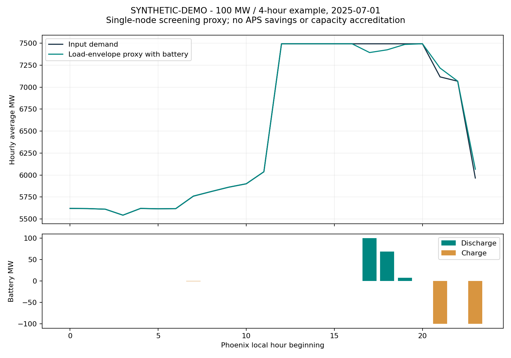
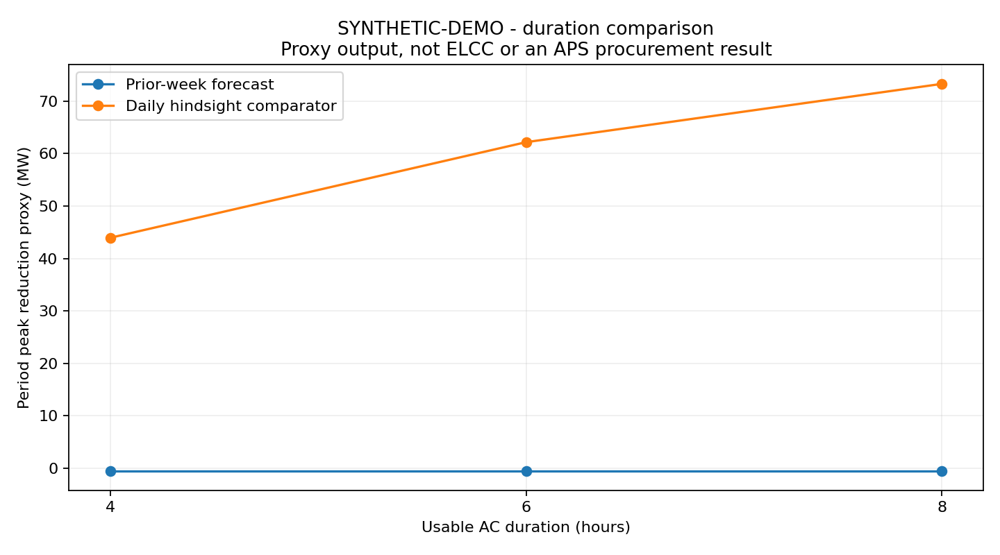

# APS Battery Feasibility Lab

## Project selection and full research blueprint

Prepared October 10, 2026 | Arizona / Arizona Public Service

**Selected project:** a source-backed battery development and dispatch lab that
compares 4-, 6-, and 8-hour storage, evaluates peak-hour support, and calculates
a hypothetical fixed contract fee required to cover stated costs.

**The decision it serves:** Which storage duration is worth investigating for an
APS-oriented project, what commercial assumptions support it, and what evidence
must be obtained before selecting a site or making an investment decision?

This release includes working Python code, 14 tests, measured AZPS summer
backtests for 2024-2026, synthetic demonstrations, public-data adapters and a
development roadmap. It is an independent research prototype. Measured inputs
are revised EIA balancing-authority demand; dispatch responses are simulated.
All project costs remain illustrative. No site study or negotiated bid is claimed.

The measured-data extension is documented in RESEARCH_UPDATE.md and the executed
notebook. Four-hour prior-week period-peak reductions are 99.5, -0.5 and 34.5 MW
in the three summers. Longer duration does not improve that metric in this
screen. One EIA-adjusted warmup hour and a reported-value sensitivity are retained.
Use the measured extension when presenting current findings; the synthetic
chapter below remains a separate demonstration of broad-plateau behavior.

The project is designed around a useful professional question: can you connect
the physical performance of a battery to the commercial terms of a development
case while preserving the difference between observed data and assumptions?
That is the central theme of every module below.

Read in order: project choice; APS context; version-one scope; datasets; battery
physics; evaluation; economics; development evidence; implementation; tests;
results; roadmap; communication; source register.

---

## 1. Why this is the strongest project

The project needs to be relevant to APS, buildable with public information, and
substantial enough to demonstrate both technical and commercial judgment. The
following comparison is qualitative judgment, not a measured scoring system.

| Candidate | Strongest feature | Main limitation | Decision |
|---|---|---|---|
| Battery trading optimizer | Concrete physics and optimization | Arizona market access and revenue assumptions need careful treatment | Keep dispatch as a module |
| Electricity-price ML model | Forecasting and evaluation skills | APS-specific tradable prices and settlement rights are incomplete | Add later after defining the decision |
| Arizona grid map | Visible local infrastructure context | Proximity does not establish interconnection capacity | Add as an evidence layer later |
| Financial model alone | Directly connects costs and contracts | Unsupported revenues can make precise returns misleading | Connect to physical performance |
| APS storage feasibility and dispatch lab | Links performance, public context and contract costs | Cannot replace private studies and bids | Selected |

The combined lab stays focused on one decision: storage-duration screening.
Mapping, forecasting and finance are useful only insofar as they improve that
decision. A polished map with no capacity evidence, or a large neural network
with no operational use case, would be less convincing for this objective.

The initial comparison holds nominal modeled power at 100 MW and varies usable
AC-output energy: 400, 600 and 800 MWh. This isolates duration. These are research
configurations, not APS-approved designs or a recommended construction scale.
In particular, net contractual delivery must account for auxiliaries and losses
at the actual delivery meter.

The first result should be a defensible explanation of what changes with duration:
peak-hour coverage, recharge requirements, capital cost and sensitivity to forecast
error. It should not be an unsupported declaration that the largest battery wins.
The next duration increment is useful only when its incremental value justifies
its incremental cost and development constraints.

---

## 2. APS-specific context and what it changes

APS's published 2025 solicitation sought at least 1,000 MW for operation mainly
in 2029-2031. Its March 18, 2026 proposal deadline has passed. The September 30
RPAC update reported 51 shortlisted proposals, including alternative battery
durations. These support studying duration now; they do not establish an open
bidding opportunity. [S2-S4]

The RFP's storage reference includes four-hour full-capacity discharge under
extreme design conditions, with longer duration preferred if cost competitive;
summer/non-summer availability requirements are 98%/97%. It includes storage
tolling as a structure. These are design references, not a claim this prototype
meets every requirement. [S3]

A Q1 2026 filing reports 3,606 MW of storage contracted through the 2023
procurement, expected in service 2026-2028 at that filing. Keep contracted,
under-construction and operating resources separate. [S5]

APS has announced expected Markets+ participation as early as 2027. Earlier
CAISO material documents APS's imbalance-market implementation. A future market
plan does not justify assuming either an ERCOT-style revenue stack or every
current CAISO product is available to an independent Arizona asset. [S6-S7]

These facts lead to three modeling choices. First, study peak support and
contract-cost screening before merchant-profit forecasting. Second, compare
duration and heat-performance assumptions explicitly. Third, date every market
and procurement input so that a later rule or planning change can be substituted
without silently rewriting the historical analysis.

APS serves a wider area than Phoenix and is not synonymous with every Arizona
utility territory. A Phoenix-area parcel must be verified against the actual
utility, transmission owner and relevant permitting authority. An Arizona map
alone cannot establish that APS is the correct buyer or interconnection provider.

Draft 2026 planning presentations are treated as context, not final adopted
resource additions. The lab does not reproduce or rely on APS's internal
production-cost model. Its conclusions are bounded by the public evidence.

---

## 3. Executable core and current measured-data extension

The executable core has two separate analyses: a physical dispatch experiment
and a developer fixed-fee cost screen. They share size assumptions but do not
pretend that a demand-shape metric is a commercial payment.

| Implemented module | Input | Output |
|---|---|---|
| Data validation | Hour-start UTC CSV | Complete, hourly Phoenix-local days |
| Battery MILP | Daily demand forecast, equipment assumptions | Charge, discharge and energy state |
| Forecast comparison | Prior-week same-hour load | Actual-day performance without target-day lookahead |
| Hindsight comparison | Actual daily load | Comparator for the same daily problem |
| Duration sweep | 4, 6 and 8 usable hours | Six matched-period dispatch comparisons |
| Cost screen | Explicit capex/O&M/augmentation assumptions | Required nominal-kW monthly fee |
| Sensitivities | Energy cost and upgrade cost | 27 scenario rows |
| Audit outputs | Configuration, input hash, run timestamp | CSV records, figures and manifest |

The simulation is a single analytical node. It minimizes a daily load-envelope
proxy with full-day foresight only for the labeled hindsight comparator. It
does not dispatch APS's generation fleet or model transmission limits. The
finance model assumes a hypothetical contract in which the buyer bears charging
energy and variable dispatch costs; the owner covers fixed costs and one
augmentation. That allocation must be changed if a real contract says otherwise.

Version one does not compute ELCC, utility procurement savings, nodal congestion,
merchant revenue, retail tariff savings or equity IRR. It does not contain a
manufacturer aging curve, a site recommendation, tax benefits or lender terms.
Those are substantive extensions that require evidence, not cosmetic toggles.

The project is deliberately useful offline. The demonstration is reproducible
without an API key. A real-data run is a separate action with an explicit source
label, and its output folder is distinct. Publishing the repository does not
deploy a website or operate a physical battery.

---

## 4. Data plan and source contracts

The first historical dataset should be hourly AZPS balancing-authority demand
from EIA-930. EIA's public AZPS monitor establishes the available reporting
context, but no measured hourly series was downloaded for this release. [S8]
Use at least three complete years for a later substantive analysis, including
multiple summers. Hold out the latest complete year after developing the model.

| Dataset | First use | Important qualification |
|---|---|---|
| EIA-930 AZPS demand | Load shapes and peak-hour experiments | Balancing-area load is not automatically retail-only APS load |
| AZPS reported forecast | Optional later baseline | Confirm issue time and preserve the original vintage |
| Weather observations | Describe heat events | Observed future weather is not an operational forecast |
| Archived weather forecasts | Later real forecasting | Include issue timestamp and location |
| Public resource records | Operating/contracted context | Verify ownership, status and commercial-operation dates |
| APS planning and procurement | Requirements register | Track publication date and revision |
| Queue and site evidence | Later development screen | Snapshot and study outcome matter; distance is insufficient |
| Vendor and financial documents | Later economics | Quote scope, exclusions and date must be explicit |

Canonical input fields are timestamp_utc, load_mw and optional availability.
Timestamps label the start of a one-hour interval and include a timezone offset.
EIA-930 reports hour-ending UTC; the adapter subtracts one hour. The EIA API
can label one-hour quantities as MWh: dividing by one hour yields average MW.
The original reporting convention and source units must be preserved. [S9-S10]

The adapter filters AZPS and demand type D, pages through the response and rejects
an incomplete requested window. The required key remains in the shell environment.
It is not written to manifests or source files. Pagination and conversion are
mock-tested; the authenticated network path has not been live verified.

Every run should retain the raw snapshot, retrieval date, exact filters, input
hash and assumptions. Do not mix a revised historical actual with a forecast
whose historical issuance is unknown and call the result an as-of trading test.

---

## 5. Data quality and Arizona time

Use UTC as the storage convention and America/Phoenix for this initial daily
grouping. The model never labels Arizona data as California time. A later site
in a jurisdiction with a different daylight-saving convention needs its own
confirmed timezone; do not generalize Phoenix's convention to every location.

Version one's loader rejects duplicate timestamps, missing intervals, null or
negative load, timezone-naive strings, non-hourly spacing and incomplete local
days. It requires eight days: seven for the prior-week forecast history and at
least one for evaluation. It performs no silent interpolation.

| Check | Current behavior | Later research upgrade |
|---|---|---|
| Duplicates | Reject | Resolve against documented source revision rules |
| Missing hours | Reject | Recover source records or disclose bounded repairs |
| Null demand | Reject | Preserve missingness and quantify excluded exposure |
| Partial days | Reject | Fetch exact local-day boundaries |
| Extreme demand | Retain if finite/nonnegative | Investigate outliers against source and weather |
| Revised observations | Record retrieval date | Retain vintage history for operational replay |
| Availability | Defaults to assumed 1 | Supply measured or scenario-specific outages |

Do not fill missing hot-afternoon demand with an average day. Missingness can be
most damaging in the exact hours used to claim storage usefulness. Report the
number of complete summers, each year's coverage, the largest gaps and whether
extreme weather dates are included before interpreting performance.

EIA reporting also has storage-accounting conventions: known charging can be
excluded from D and reported as a negative contribution to net generation.
Therefore load + charge - discharge + auxiliary consumption is this project's
analytical load envelope; it is not a prediction of the new published EIA D
series or APS's residual generation requirement. [S9]

Do not subtract every EIA solar-generation observation from demand and label it
APS net load. Ownership, exports, distributed generation treatment and existing
fleet operation require reconciliation. Any future residual-load model should
state its equation, resource boundary and source treatment separately.

---

## 6. Battery physics and optimization

Power measures the discharge rate; energy measures how much can be delivered.
100 MW at the modeled AC-output boundary for four hours corresponds to 400 MWh
of usable AC-output energy. Raw installed DC cell capacity is a different
quantity and may need oversizing for usable range, conversion losses, aging and
contractual obligations.

The model stores energy in an AC-deliverable coordinate. With one-hour intervals:

E[t+1] = E[t] + RTE * C[t] - D[t]

Here E is usable MWh, C and D are charging/discharging MW at the modeled AC
boundary, and RTE is the recharge-to-later-discharge efficiency. This convention
places the round-trip loss on charging. Do not separately apply the same loss
again to discharge. A later DC-coordinate model should use separate charge and
discharge efficiencies consistently instead.

Constraints enforce 0 <= E <= usable capacity, bounded charge/discharge power,
exclusive modes and equal starting/ending energy for each local day. A binary
mode variable prevents simultaneous charging and discharging. There is no free
depletion of initial stored energy at the end of the experiment.

The optimizer minimizes z, where every forecast load-envelope hour is <= z,
with a small throughput tie-breaker. This is a peak-shape experiment, not an
energy-price objective. SciPy's MILP solver supplies the optimization interface;
the code independently checks conservation and physical bounds afterward. [S14]

Auxiliary consumption is an explicit constant grid burden in this version.
At 100 MW modeled discharge and 0.5 MW auxiliaries, maximum net support is
99.5 MW. The model does not certify a 100 MW delivery-meter commitment. Uniform
power derating and known availability multiply equipment power; they do not
replace vendor ambient-temperature curves or unknown outage behavior.

Initial and terminal state are 50% of usable energy every day. This simplifies
comparison but prevents multiday scheduling and is not an assertion about APS
operations. The first important extension is SOC carryover with a rolling
48-72 hour horizon and a defensible terminal energy value or reserve target.

---

## 7. Backtesting and performance measures

Use identical evaluated days for every duration and strategy. The lag-7 schedule
uses the same hourly observations from seven days earlier. None of the target
day's actual load is used to form that schedule. Actual target-day load is used
after scheduling to evaluate the result.

The hindsight comparator uses actual daily load and is labeled accordingly.
It answers how well this specific daily problem could perform with demand
foresight. It is not a forecast, a global multiyear optimum or an achievable
profit estimate. The more limited forecast may select the wrong discharge
hours, and a larger battery can still perform poorly under forecast error.

| Metric | Definition | What it does not establish |
|---|---|---|
| Period peak reduction proxy | Max baseline minus max adjusted over matched days | Accredited capacity or avoided cost |
| Mean daily reduction proxy | Average daily baseline peak minus adjusted peak | Annual firm capacity |
| Worst daily reduction proxy | Minimum daily reduction, negatives retained | Extreme-system reliability |
| Top-100-hour support | Average D-C-aux at highest baseline hours | Utility-defined critical-hour payment |
| Forecast MAE | Mean absolute actual/lag-7 error | Dispatch value by itself |
| Equivalent usable cycles | Total discharged MWh / usable MWh | Warranty life under arbitrary definitions |
| Charge/discharge energy | Hourly totals using one-hour intervals | Market settlement or revenue |

Historical actuals downloaded later can be revised. Avoiding target-day lookahead
is useful but does not make the test a true historical information-set replay.
The current model also knows each day's supplied availability profile in advance.
Unknown forced outages and their correlation with heat must be tested separately.

Later baseline improvements should include a fixed schedule, utility reported
day-ahead forecast if its issuance is validated, and a weather-based model.
Compare out-of-sample peak-hour errors and dispatch outcomes, not just overall
MAE. Keep a simple method if a sophisticated forecast fails to improve the actual
decision. Never tune the final model on the held-out evaluation year.

System adequacy requires fleet and outage context beyond this experiment. A
claim of ELCC or loss-of-load improvement needs an adequacy model and should be
reported as a separate result with its own assumptions and validation.

---

## 8. Developer economics: the fixed-fee screen

The first commercial model asks what hypothetical level fee would cover a
specified cost stream at a chosen unlevered discount rate. It does not claim
APS would pay that fee. This inverse calculation is more transparent than
inventing a contract price and reporting a precise investment return.

Assume a buyer-controlled dispatch contract, with buyer-paid charging energy and
variable dispatch costs. The seller pays initial capital, annual fixed O&M and
one augmentation. This is a research contract allocation; verify ownership of
energy, losses, auxiliary consumption, market proceeds and performance liability
in any real term sheet before changing cash flows.

Capex = (power kW * power cost + usable AC kWh * energy cost
         + interconnection + development) * (1 + contingency)

Annuity factor = sum of 1 / (1 + real discount rate)^year

Required fee = PV(all modeled costs) /
               (nominal power kW * 12 * assumed paid availability * annuity factor)

The resulting fee is USD per nominal kW-month in constant real dollars. The code
checks that the cash-flow NPV at that fee is approximately zero. The assumed
availability multiplier is a simplification, not the negotiated APS settlement
formula or evidence that a project satisfies contractual availability.

| Input | Illustrative base | Meaning |
|---|---|---|
| Nominal modeled power | 100 MW | Battery AC output before auxiliaries |
| Power-related capex | $350/kW | User-adjustable assumption |
| Energy-related capex | $180/usable AC kWh | User-adjustable assumption |
| Interconnection allowance | $15 million | No utility study obtained |
| Development allowance | $5 million | No site budget obtained |
| Contingency | 10% | Applied to the listed initial subtotal |
| Fixed O&M | $20/kW-year | No vendor operating quote obtained |
| Augmentation | $30/usable AC kWh in year 10 | Stylized payment, not a battery-aging model |
| Horizon / real discount rate | 20 years / 8% | Screening assumptions |
| Paid availability multiplier | 98% | Commercial assumption only |

These figures are intentionally inspectable placeholders. A historical ATB
cost framework informs how power and energy costs can be separated, but no
configuration number is represented as an ATB value or current quote. [S13]

---

## 9. Economics that must be added before investment use

Separate the buyer's system value from the developer's cash flow. A buyer may
value capacity, reduced production cost, flexibility and reliability. A developer
gets the payments allocated by a contract and bears its own costs and liabilities.
Those are different accounting boundaries.

Do not add a full merchant-profit forecast to a fixed-fee contract whose buyer
owns dispatch and energy proceeds. Add only contractually retained revenue.
Do not add retail demand-charge savings to a utility-scale front-of-meter case
without a valid tariff and customer-meter boundary.

| Missing item | Why it could change the conclusion | Evidence needed |
|---|---|---|
| Network upgrades | Can dominate incremental duration economics | Actual studies and cost allocation |
| Heat/aging guarantees | May require extra installed cells or power | Vendor curves and delivered-energy warranty |
| Collateral | Creates financing and liquidity requirements | Current procurement/contract terms |
| Debt and reserves | Changes equity cash flow and constraints | Lender term sheet and covenants |
| Taxes and credits | Changes eligible cash-flow timing | Current project-specific tax analysis |
| Land and property costs | Site-dependent annual and upfront burden | Lease/option, assessor and insurance inputs |
| Energy and loss allocation | Changes dispatch-linked costs | Metering and commercial agreement |
| Availability penalties | Can make a nominal fee inadequate | Definitions, exceptions and damages schedule |
| Construction timing | Delays income and adds carrying costs | EPC milestones and funding schedule |
| Decommissioning | Adds end-of-life obligations | Site/contract requirements and budget |

Use real discount rates with constant-real-dollar cash flows, or nominal discount
rates with escalated nominal cash flows. Mixing them distorts the required fee.
Version one uses constant real dollars and does not estimate interest during
construction, cost inflation or salvage value.

Run targeted scenarios before probabilistic simulations. Change interconnection,
energy capex, duration, heat-power factor, efficiency, life and augmentation.
If a single unsupported input controls the conclusion, report that dependency.
A Monte Carlo distribution over invented inputs does not create new evidence.

After real load and verified costs are available, show the incremental 6-versus-4
and 8-versus-6 case: additional cost, additional useful performance, required
commercial value, and the missing facts that could reverse the ranking.

---

## 10. Site and interconnection evidence

The first site feature should be an evidence register, not a colored map that
implies available grid capacity. APS's public FERC interconnection page points
to its tariff/OASIS materials; no study or available-capacity conclusion was
obtained for this release. [S11]

Start with three hypothetical site categories: an existing generation site,
an industrial-area candidate, and a new rural parcel. Do not attach a real parcel
name, owner or preferred location until the required evidence is checked.
These categories are comparison cases, not development recommendations.

| Field | Purpose | Acceptable evidence |
|---|---|---|
| Territory and network owner | Identify correct counterparties | Utility map plus specific confirmation |
| Point of interconnection | Define physical delivery | Identified bus, ownership and documented study path |
| Capacity and upgrades | Establish technical feasibility | Applicable utility/network studies |
| Land control | Establish development rights | Signed option/lease and access rights |
| Zoning and jurisdiction | Identify permitting authority | Current parcel and jurisdiction records |
| Fire and emergency access | Validate design approval path | Current authority review and site design |
| Drainage and environmental risks | Identify constraints | Relevant maps, surveys and specialist findings |
| Equipment and civil access | Assess logistics | Site plan and construction scope |
| Schedule and cost confidence | Test commercial-operation timing | Study, procurement and permitting milestones |

Phoenix publishes battery/solar fire-permit resources, but their availability
does not mean a particular utility-scale design is approved or that every Arizona
parcel falls under Phoenix rules. [S12] Design-level safety and legal conclusions
are outside this code's scope.

Use status values such as unknown, preliminary, verified or blocking. Unknown
interconnection cost is a visible unknown, not zero. A short straight-line
distance to a transmission line is not proof of a viable connection. Any future
ranking should keep unverified candidates unranked rather than burying missing
technical facts in a numerical score.

A useful site report explains the next study that could resolve uncertainty and
the development budget at risk before resolution. It does not represent itself
as an engineering interconnection study or a permit approval.

---

## 11. Implementation and how to run it

The repository has a small executable core so each module can be understood.
lab.py contains the equipment model, validator, dispatch MILP, forecast baseline,
fixed-fee calculation and plotting. fetch_eia.py is a separate optional public
data adapter. config.json holds assumptions; test_lab.py checks the important
behaviors. README.md is the entry point for a GitHub reviewer.

Create a Python virtual environment, install requirements, run the tests and
then run lab.py. The default demonstration needs no external account. It writes
synthetic_input.csv, hourly_dispatch.csv.gz, dispatch_summary.csv, finance_screen.csv,
cost_sensitivity.csv, a run manifest and two plots into results/demo.

For a later measured-data run, set your own EIA_API_KEY in the environment and
run fetch_eia.py with a Phoenix-local inclusive start date and exclusive end
date. Then pass the resulting CSV to lab.py with an explicit source-label and
a separate results/real directory. The authenticated API path must first be
verified on the machine performing the download.

| Function | Plain-language role |
|---|---|
| Battery | Defines power, energy duration and physical assumptions |
| validate_frame | Enforces the hourly CSV data contract |
| solve_day | Chooses physically feasible charge/discharge hours |
| forecast_day | Builds the simple same-hour prior-week forecast |
| finance | Finds the hypothetical cost-covering fee |
| run | Executes duration/strategy comparisons and writes evidence |
| fetch_pages | Retrieves a complete paginated API response |
| normalize_rows | Converts source labels and units to the canonical contract |

The optimizer's constraints are intentionally visible in code. If you explain
the project to someone, start with power versus energy, then the state update,
then the scheduling objective. Explain the distinction between the physical
experiment and the financial screen before showing a monetary number.

No remote repository has been created as part of this preparation. The connected
account was jfasoxx; the available integration needs an existing repository URL.
Publication should include code, source register, guide and labeled demo output.
API keys, virtual environments and later private data must remain excluded.

---

## 12. Verification and what a passing test means

The current 14 automated tests passed during preparation. They verify energy
conservation, recharge losses, no simultaneous modes, unchanged terminal energy,
dispatch shutdown during a known outage, heat-power limits, the flat-load sanity
case, duration behavior under hindsight, invalid-input rejection, target-day
lookahead exclusion, the financial break-even identity and API adapter behavior.

These tests establish internal model properties. They do not verify an APS
contract, vendor product, utility data accuracy or a site. The optional network
downloader was tested with simulated API responses, not a live key.

| Validation stage | Acceptance criterion |
|---|---|
| Model physics | No bound, conservation or mode violation in exported records |
| Temporal evaluation | All strategies use the same post-warmup observations |
| Finance algebra | NPV at required fee equals zero within numerical tolerance |
| Data provenance | Exact input hash, source label and timestamp convention saved |
| Visual QA | Readable chart/PDF labels and explicit data-mode markings |
| Real-data extension | Source totals and extreme-day coverage reconciled |
| Forecast extension | Issue-time inputs verified; held-out performance reported |
| Development extension | Evidence distinguishes unknowns from verified constraints |

Before accepting a real-data conclusion, compare source rows with the monitor
on selected normal and extreme days. Check timezone shifts manually. Confirm
that the evaluation interval includes charging as well as discharge and that
initial/final energy treatment does not give one strategy an advantage.

Audit commercial units: MW versus kW, MWh versus kWh, USD/kW-month versus
USD/MWh, usable capacity versus raw installed capacity. A thousand-fold unit
error can survive a visually convincing presentation.

When extending the model, test the new decision-relevant behavior rather than
just its implementation. For rolling dispatch, test conservation across day
boundaries. For aging, test that guarantees can be sustained or fail visibly.
For a contract penalty, test the cash-flow impact of the defined event. Keep
the old tests so added features do not quietly weaken the original guarantees.

---

## 13. How to interpret the included demonstration

The demonstration fabricates 42 summer-style days, including narrow peaks and
broad evening plateaus. Seven days provide forecast history and 35 are evaluated.
The shapes are purpose-built to exercise the model. They are not calibrated to
APS history and should not be used to recommend an Arizona project size.

The two figures below are synthetic outputs from the current implementation.
They illustrate schedule behavior and duration comparisons. The actual values
can be inspected in the accompanying CSV files; no market revenue is computed.

The forecast result can lag the hindsight comparator because the prior week's
load does not match a new broad heat-event shape. That demonstrates the value
of evaluating schedules on actual held-out observations, but it is not evidence
that an APS forecasting method performs similarly.

If longer duration improves a proxy metric, it still needs an economic and
reliability justification. If it does not improve that metric, that alone does
not prove it has no value: reserve obligations, duration accreditation and
commercial duties are absent from this prototype. Keep each conclusion inside
the boundaries of the experiment that produced it.

---

## 14. Roadmap to a serious APS research project

The milestones below are suggested work packages, not claims that unfinished
modules already exist. Complete each evidence gate before moving to stronger
commercial conclusions.

| Phase | Work | Completion evidence |
|---|---|---|
| A: usable starter | Code, tests, synthetic outputs, primary sources | This release |
| B: measured history | Three AZPS summer snapshots, correction sensitivity; weather remains open | Summer demand complete with provenance and coverage review |
| C: operational replay | Forecast vintages, rolling SOC and outages | Matched out-of-sample dispatch results |
| D: physical realism | Ambient derating, aging, auxiliaries and reserve limits | Vendor assumptions and sensitivity results |
| E: commercial screen | Contract allocation and verified cost ranges | Clear fee/cost bounds and missing-term list |
| F: development screen | Territory, site control, study path, permitting | Evidence-backed candidates and unresolved blockers |
| G: professional review | Technical and commercial practitioner feedback | Recorded fixes and bounded conclusions |

A reasonable first working sequence is: run the demo; explain every variable;
fetch one complete real year; inspect ten peak days; compare durations with the
simple forecast; stress temperature and costs; document the limitations; then
add better forecasting or an evidence-based site view.

The measured summer extension is now complete. The next work is full-year and
future net-load validation, rolling SOC and heat/outage realism rather than
adding decorative maps. Build a web interface only when it makes the actual
decisions and source boundaries clearer.

The project can eventually support separate professional questions: resource
planning asks about system value; an independent developer asks about the contract
and execution path; a lender asks about downside cash flow and guarantees. Keep
those analyses separate and tie them to the same documented equipment and source
assumptions. Shared inputs do not mean shared conclusions.

The initial deliverable is strong because it is runnable and inspectable. A
serious later result will be stronger because verified evidence changes the
decision, not because the project claims to do more than its data support.

---

## 15. Presenting the project accurately

An accurate GitHub introduction is: "Independent APS-oriented battery research
lab comparing storage duration, forecast dispatch and the fixed fee needed to
cover explicit illustrative costs. Includes physically constrained optimization,
data validation, reproducible synthetic examples and a real-data adapter."

Avoid descriptions such as "built APS's trading system," "found the best Arizona
battery site," "proved a profitable 100 MW project," or "reduced APS costs by
the chart's MW value." Those would attribute access, validation or commercial
results the repository does not have.

When showing the project, be ready to answer these questions:

- What exactly does the load-envelope proxy measure?
- Which data are measured, and which are synthetic?
- Why does longer duration sometimes help and sometimes not?
- How are energy losses and auxiliaries counted?
- How do you prevent future information from entering a forecast?
- Who pays for charging and owns the energy proceeds in the financial case?
- Which cost inputs could reverse the ranking?
- What would an interconnection study establish that a map cannot?
- What is implemented, and what remains on the roadmap?

The current answer to project selection is definite: this combined storage
feasibility and dispatch lab is the best of the discussed options for a focused
APS-oriented project. The eventual answer to investment selection remains open:
actual project economics and feasibility require measured data, quotes, studies
and commercial terms that are not yet present.

Consult SOURCES.md for the complete primary-source register, publication dates,
source limitations and URLs. All source claims are bounded to their reporting
period. No APS source PDF, private attachment, brand asset or confidential input
has been redistributed in the repository.
