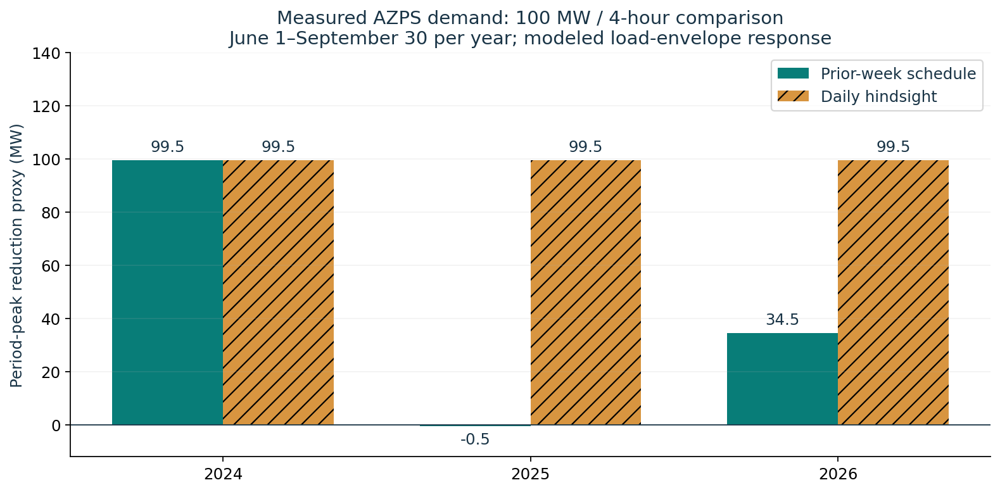

# APS Battery Feasibility Lab

**An independent Arizona-focused research prototype comparing battery duration,
peak-hour support, and the fixed contract fee needed to cover illustrative costs.**

Not affiliated with or endorsed by Arizona Public Service (APS). Research cut:
October 10, 2026. The primary study uses **measured EIA AZPS demand for summers 2024–2026**.
The synthetic demonstration is labeled separately. Dispatch responses are modeled;
all project costs remain illustrative.

## Start here

- [Executed reviewer notebook](notebooks/APS_Battery_Review.ipynb): measured results, failure analysis, cost sensitivities and reproducibility checks.
- [Measured-data research update](RESEARCH_UPDATE.md): current sources, data adjustment, findings and development recommendation.
- [Full project guide](docs/APS_Project_Guide.pdf): methodology and APS development context.
- [Application and interview notes](APPLICATION_NOTES.md): a concise description and questions to understand before submitting.

## Measured summer findings

For a 100 MW four-hour system, before 0.5 MW of auxiliaries:

| Summer | Prior-week peak reduction proxy (MW) | Daily hindsight comparator (MW) |
|---|---:|---:|
| 2024 | 99.50 | 99.50 |
| 2025 | -0.50 | 99.50 |
| 2026 | 34.50 | 99.50 |

Each summer evaluates June 1–September 30, 122 complete Phoenix-local days.
Six/eight hours do not improve these period-peak results. **Use four hours as a
reference for further diligence** within this daily demand-only screen. Future
net load, reliability value and buyer dispatch requirements could change duration
selection. These modeled reductions are not ELCC, measured APS savings or project approval.



The baseline uses EIA's Adjusted demand consistently. EIA adjusted one May 2026
warmup value; the raw reported-value sensitivity is preserved. Input snapshots,
hashes and quality counts are included. Historical revised data does not establish
a historical as-of operational replay.

## Why this project

The central question is: **How do 4-, 6-, and 8-hour batteries compare for an
APS-oriented development case, and what costs or performance limits could change
the decision?** It combines grid data, physically constrained optimization, and
project economics. It is more useful for this question than a standalone map,
an ML forecast without a dispatch use case, or an ERCOT trading model relabeled
Arizona.

APS's published 2025 All-Source RFP provides a concrete reference for storage
duration, technical requirements and contract structures. Its original proposal
deadline was March 18, 2026. This project is a research exercise, not a submission
to a currently open solicitation. The September 30, 2026 RPAC update reported
shortlisted proposals and multiple battery-duration configurations. See
[SOURCES.md](SOURCES.md) and [PROJECT_GUIDE.md](PROJECT_GUIDE.md) for source scope.

## What works in version 0.2

- Three measured summers, a reported-value data-quality sensitivity, a power
  derating case and an ATB-inspired performance/O&M scenario.
- An executed reviewer notebook and independent CSV physics/finance audits.
- Hourly battery dispatch solved with a mixed-integer linear program (MILP).
- Charging losses, usable energy, charge/discharge exclusivity, power derating,
  explicit auxiliary load, and equal initial/terminal daily state of charge.
- Forecast dispatch using the same hours seven days earlier, compared with a
  daily hindsight schedule on the exact same evaluation days.
- 4-, 6-, and 8-hour configurations at an illustrative 100 MW AC battery-output rating.
- A pre-tax, unlevered, constant-real-dollar fixed-fee screen and 27 cost sensitivities.
- CSV imports with strict UTC/timezone, coverage, missingness and duplicate checks.
- An EIA AZPS demand downloader using your own API key; pagination and conversion
  are mock-tested. **A live authenticated download has not been verified here.**
- Exported dispatch records, summary tables, figures, and a run manifest.
- Physics, data-contract, finance, pagination and forecast-lookahead tests.

## Quick start

Use Python 3.12 to match the validated environment. From this repository's directory:

```bash
python3 -m venv .venv
source .venv/bin/activate
python -m pip install -r requirements-reproducible.txt
python -m unittest -v
python lab.py
python verify_results.py results/demo
python run_study.py
```

On Windows, activate with `.venv\Scripts\activate` and use `python`.
The broader `requirements.txt` allows other scientific package versions. For
reproducing saved metrics, use the pinned direct versions above: MILP solutions
can choose different equivalent forecast schedules across solver versions.
The default demo fabricates 42 full summer-style days, reserves seven for history,
and evaluates the remaining 35. It contains **zero measured APS observations**.

Try an illustrative power-derating stress:

```bash
python lab.py --power-factor 0.9 --out results/heat_stress
```

This is a user-selected 10% reduction, not an APS specification or a measured
manufacturer heat curve. It reduces charging and discharge power uniformly.

## Reproduce the measured study

`python run_study.py` uses included public snapshots and runs six measured-data
cases: three summers, 2026 raw reported demand, 10% power derating, and the
ATB-inspired performance/finance scenario. Each case exports 17,568 hourly
comparison records. Independent audits verify power/SOC limits, energy balance,
exclusive operating modes, aligned periods, summary reconciliation and fee NPV.

To open or execute the notebook:

```bash
python -m pip install -r requirements-notebook.txt
python -m jupyter nbconvert --execute --to notebook --inplace notebooks/APS_Battery_Review.ipynb
```

The saved notebook was executed sequentially using IPython in-process because
local kernel sockets were unavailable during preparation. GitHub's workflow is
configured to repeat it in a standard Jupyter kernel. Check the Actions tab for
remote validation status.

## Refresh public AZPS demand without a key

EIA publishes a large AZPS workbook with hourly history. This route was downloaded
and inspected for this release; refreshing may take a minute and revisions can
change results. Choose the source column explicitly:

```bash
python fetch_public_eia.py --start 2026-05-25 --end 2026-10-01 --value-column "Adjusted demand" --out data/real/azps_summer_2026.csv
```

The bundled `data/public` snapshots use EIA Adjusted demand and include provenance.
`Demand` selects the reported values instead. No silent local imputation occurs.
Do not replace a published snapshot without updating its provenance and rerunning
its cases.

## Optional authenticated EIA API route

Obtain a free EIA API key from [EIA Open Data](https://www.eia.gov/opendata/).
Set `EIA_API_KEY` in your shell environment without committing it. Then:

```bash
python fetch_eia.py --start 2024-01-01 --end 2025-01-01 --out data/real/azps_2024.csv
python lab.py --input data/real/azps_2024.csv --source-label "EIA-930 AZPS D; revised 2024 hourly demand" --out results/real/2024
```

The end date is exclusive, and dates refer to **Phoenix-local days**. EIA's
hour-ending UTC labels are shifted back one hour for this model's hour-start
contract. For one-hour intervals, a reported MWh quantity divided by one hour is
numerically the average MW. The downloader checks units and writes a provenance
file without the API key. It rejects incomplete coverage rather than filling it.

Use EIA's API browser to recheck route metadata if a future API change occurs.
Downloaded data may be revised; a historical series downloaded today is not
proof of what the operator knew on that historical day.

## CSV contract

| Column | Meaning |
|---|---|
| `timestamp_utc` | Hour-start ISO timestamp with `Z` or explicit UTC offset |
| `load_mw` | Nonnegative hourly average load in MW |
| `availability` | Optional deterministic dispatch fraction 0 to 1; defaults to 1 |

At least eight complete Phoenix-local days are required. No gaps, duplicate
timestamps or null loads are accepted. All intervals must be exactly one hour.
EIA demand is a balancing-authority measure, not automatically APS retail-only
load. The modeled `adjusted_load_proxy_mw` is an analytical load-envelope
calculation; it is **not a rewritten EIA D series** or a reconstruction of APS's
generation dispatch. EIA storage accounting can assign known charging to net
generation rather than demand, which is another reason to keep this distinction.

## Read the results correctly

| Output | Interpretation |
|---|---|
| `dispatch_summary.csv` | Evaluated-day load-envelope peak reductions and dispatch metrics |
| `hourly_dispatch.csv.gz` | Auditable charge/discharge/SOC records for all six comparisons |
| `finance_screen.csv` | Required hypothetical fixed fee in USD per nominal kW-month |
| `cost_sensitivity.csv` | Interconnection and battery-energy-cost sensitivity grid |
| `run_manifest.json` | Exact assumptions, input hash, timestamp conventions and exclusions |
| `dispatch_example.png` | 4-hour forecast schedule on the highest input-demand day |
| `duration_comparison.png` | Duration comparison for this run only |

`period_peak_reduction_proxy_mw` compares the highest input load with the highest
adjusted proxy over the same evaluated period. It does not measure capacity
accreditation, avoided generation cost, transmission relief, or bill savings.
Charging can move the highest adjusted hour. Negative daily reductions remain
visible; the model does not hide forecast failures.

The hindsight strategy knows the actual day's demand and is a comparator for
this daily scheduling problem. The lag-7 strategy has no target-day load
lookahead, but it assumes the historical input values and any availability
schedule were already available. Revised data and known-ahead availability
prevent this from being a full historical as-of operational replay.

## Financial boundary

Every numerical cost in `config.json` is **illustrative**, not an APS bid,
manufacturer quote, 2026 market estimate or validated project budget. The
screen assumes a hypothetical fixed-payment contract in which the buyer pays
charging energy and variable dispatch costs while the owner pays fixed O&M
and one augmentation. Payment is simplified as a fixed availability multiplier.
The code does not assert APS uses this exact settlement mechanism.

The fee covers modeled costs at an assumed 8% real unlevered discount rate.
It is not a claimed achievable contract price or equity return. Taxes, tax
credits, debt, collateral carrying costs, working capital, disposal, variable
seller costs and inflation are excluded. Do not stack spot-market profits on
top of a contract that assigns dispatch and those profits to the buyer.

`power_mw` is the modeled AC battery-output rating **before auxiliary load**.
At 100 MW and 0.5 MW of auxiliaries, maximum net support is 99.5 MW. Usable MWh
is defined at the battery AC-output boundary. A real 100 MW net-delivery contract
needs equipment sizing and auxiliaries treated at its exact delivery meter;
this prototype does not certify contract compliance.

## Repository structure

```text
lab.py                    Dispatch, validation, financial screen and plots
fetch_eia.py              Optional authenticated public-data adapter
fetch_public_eia.py       Key-free EIA workbook adapter
run_study.py              Six measured-data experiments
verify_results.py         Independent exported-record audits
notebooks/                Executed reviewer analysis
data/public/              Measured snapshots with provenance
config.json               Explicit illustrative assumptions
test_lab.py               Meaningful physics, data and finance tests
SOURCES.md                Primary source register and freshness notes
PROJECT_GUIDE.md          Detailed methodology, roadmap and development framing
docs/APS_Project_Guide.pdf Polished version of the guide
results/demo/             Reproducible synthetic outputs
```

## Next substantive upgrades

1. Extend the three measured summers to full-year adequacy and future net-load scenarios.
2. Add archived weather forecasts and manufacturer heat curves; preserve as-of vintages.
3. Replace daily cycling boundaries with rolling 48-72 hour scheduling and SOC carryover.
4. Add aging, warranty limits, stochastic correlated outages and reserve requirements.
5. Keep buyer avoided-cost analysis separate from developer contract cash flow.
6. Add site and interconnection evidence before naming a preferred physical project.

This repository is suitable for a transparent research demonstration. It is not
a bidding engine, interconnection study, lender model or live grid controller.

## Project provenance and publication

Public repository: [jfasoxx/aps-battery-feasibility-lab](https://github.com/jfasoxx/aps-battery-feasibility-lab).
Prepared with AI assistance. The original model and analysis are research work;
understand and reproduce the calculations before describing your contribution
in an application. No APS logos or proprietary documents are included. Public
APS documents are linked, not redistributed. See `PUBLISHING.md` for local use.
